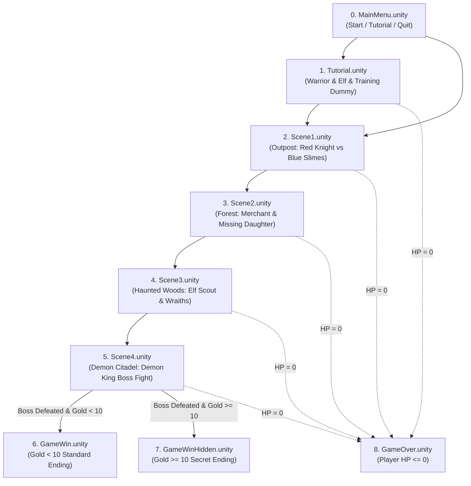
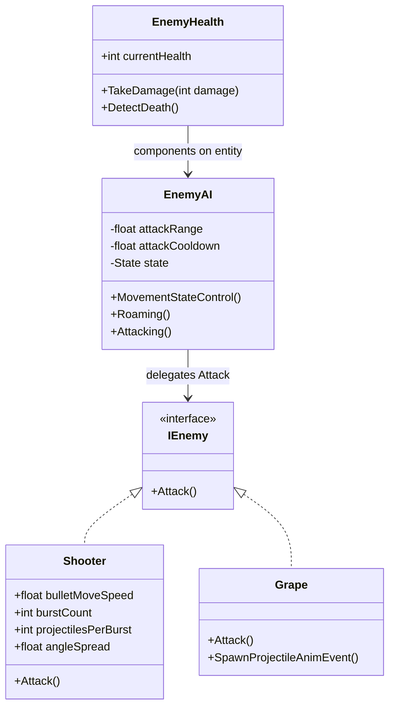
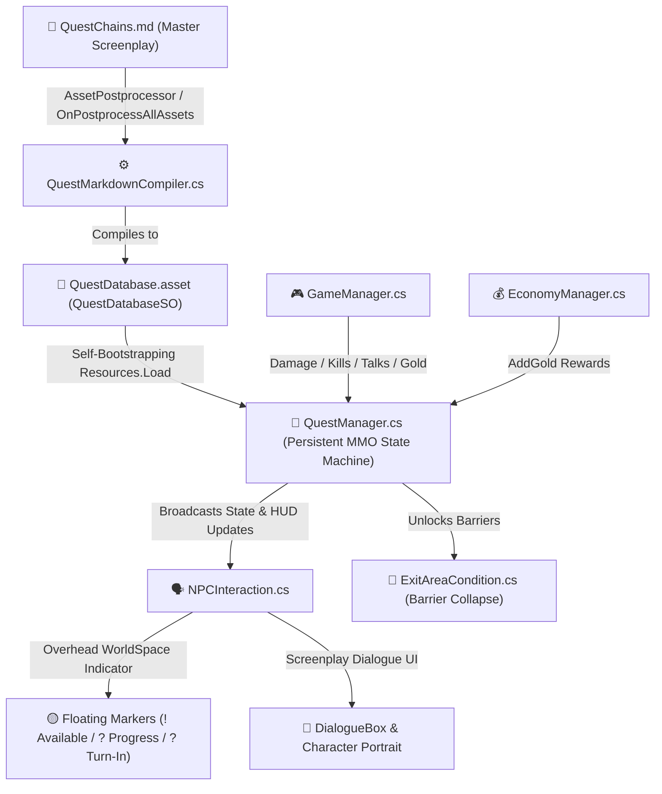
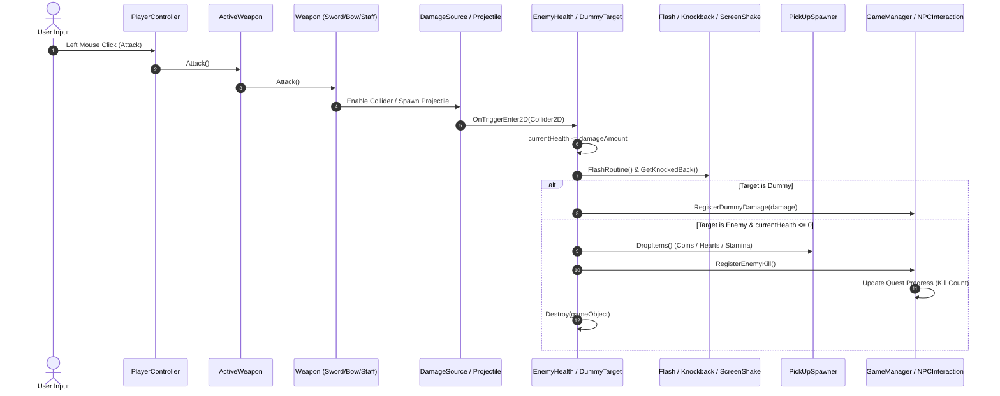
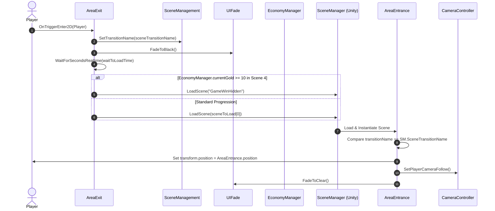

# Capstone Game Prototype: 2D Top-Down Action RPG
*A Top-Down 2D Action-Adventure Game with Real-Time Combat, Companion AI, Dynamic Quest Chains, and Multi-Ending Boss Battles.*

---

## 📋 Table of Contents
1. [Project Overview & Engine Version](#-project-overview--engine-version)
2. [Packages & Dependencies](#-packages--dependencies)
3. [Game Core Mechanics & Systems](#-game-core-mechanics--systems)
4. [Controls & Input Mapping](#-controls--input-mapping)
5. [Storyline & Scene Walkthrough](#-storyline--scene-walkthrough)
6. [Combat, Weapons & Equipment](#-combat-weapons--equipment)
7. [AI Companion System (The Loyal Dog)](#-ai-companion-system-the-loyal-dog)
8. [Enemy Hierarchy & Boss Mechanics](#-enemy-hierarchy--boss-mechanics)
9. [Quest & Dialogue Architecture](#-quest--dialogue-architecture)
10. [Economy, Pickups & Destructibles](#-economy-pickups--destructibles)
11. [Audio & Visual Effects (VFX/SFX)](#-audio--visual-effects-vfxsfx)
12. [Architectural Deep Dive & Sequence Pipelines](#-architectural-deep-dive--sequence-pipelines)
13. [Comprehensive Script Catalog & Reference](#-comprehensive-script-catalog--reference)
14. [Project Hierarchy & Asset Structure](#-project-hierarchy--asset-structure)
15. [Code Quality & Optimization Roadmap](#-code-quality--optimization-roadmap)

---

## ⚙️ Project Overview & Engine Version

| Parameter | Specification | Details / Source |
| :--- | :--- | :--- |
| **Project Title** | `Capstone_Game_Prototype_JM_George` | Top-Down 2D Action-RPG Prototype |
| **Product Name** | `2DTopDown` | Configured in `ProjectSettings.asset` |
| **Bundle Version** | `1.1` | Build version code `1` |
| **Unity Editor Version** | **`6000.6.7f1` (Unity 6 Tech/Preview)** | Revision `b22767f04f04` (`ProjectVersion.txt`) |
| **Render Pipeline** | **Universal Render Pipeline (URP 2D)** | Package version `17.6.0` |
| **Input System** | **Unity New Input System** | Package version `1.20.1` |
| **Audio Engine** | Unity Audio Module + Custom `AudioManager` | Stereo BGM & SFX routing |
| **Target Platforms** | PC / Desktop (Gamepad & Keyboard/Mouse supported) | Standalone Windows/Mac |

---

## 📦 Packages & Dependencies

All dependencies are defined in `Packages/manifest.json`:

### Core Engine & Feature Packages
* **`com.unity.render-pipelines.universal` (17.6.0)**: Powers the 2D lighting, 2D sprite render passes, custom materials, and post-processing volumes.
* **`com.unity.inputsystem` (1.20.1)**: Event-driven input handling supporting cross-platform mouse, keyboard, and gamepad controls (`Player Controls.inputactions`).
* **`com.unity.cinemachine` (6.6.0)**: Dynamic virtual camera management with smooth orthographic player tracking and impulse-based screen shake.
* **`com.unity.ugui` (2.6.0)**: Canvas rendering, interactive UI buttons, health sliders, dialogue displays, and integrated **TextMesh Pro** (`TMP`) fonts.
* **`com.unity.feature.2d` (2.0.2)**: 2D sprite handling, sprite animation, physics 2D, and tilemap workflow.
* **`com.unity.visualscripting` (1.9.12)**: Node-based scripting engine integrated into Unity.
* **`com.unity.timeline` (6.6.0)**: Cinematic sequences and cutscene animation timeline controls.
* **`com.unity.postprocessing` (3.5.4)**: Fallback and post-processing stack utilities.
* **`com.unity.services.authentication` (3.8.0)** & **`com.unity.multiplayer.center` (2.1.0)**: Unity gaming services integration hooks.
* **`com.unity.test-framework` (1.8.0)**: Automated test runner and assertion framework.

### Built-in Modular Engine Components
* `com.unity.modules.physics2d` & `com.unity.modules.physicscore2d`: 2D Rigidbodies, capsule/box colliders, trigger queries, and overlap physics.
* `com.unity.modules.tilemap`: Grid, Tilemap, and composite collider environments.
* `com.unity.modules.audio`: AudioSource, AudioListener, and 2D spatialized sound.
* `com.unity.modules.particlesystem`: Visual particle effects for hits, death VFX, slashes, and magic sparks.
* `com.unity.modules.animation`: Mecanim Animator state machines for Player, Dog, Enemies, and UI transitions.

---

## 🎮 Game Core Mechanics & Systems

### 1. Game Loop & Objective
The player embodies a courageous **Traveler** journeying into a corrupted realm tainted by the **Demon King**. 
1. **Tutorial**: Learn basic movement, dashing, weapon attacking, and companion commanding by sparring with the **Warrior Chief** and beating the **Training Dummy**.
2. **Defend Outpost (Scene 1)**: Aid the **Red Knight** by purging corrupt **Blue Slimes**.
3. **Rescue in the Woods (Scene 2)**: Help a distressed **Merchant** eliminate monsters and safely rescue his **Daughter**.
4. **Rescuing the Fallen Hero (Scene 3)**: Rally with the **Elf Scout** to purge spectral **Wraiths** and hostile eye fiends.
5. **The Demon Citadel (Scene 4)**: Enter the heart of evil to challenge the **Demon King** (400 HP Bullet-Hell Boss).
6. **Multi-Ending Resolution**:
   - 🏆 **Standard Victory (`GameWin`)**: Defeat the Demon King and escape through the exit portal with **under 10 Gold Coins**.
   - 🌟 **Hidden / Secret True Victory (`GameWinHidden`)**: Collect **10 or more Gold Coins** scattered across destructibles and enemy drops, defeat the Demon King, and unlock the secret ending!
   - 💀 **Game Over (`GameOver`)**: If the player's health drops to 0, play death animation, wipe gold, and transfer to Game Over.

### 2. Player Attributes
* **Health System (`PlayerHealth.cs`)**:
  - Maximum 3 Health Points represented by a dynamic UI Slider.
  - On taking damage: Screen shakes, knockback is applied, sprite flashes white (`Flash.cs`), and the player gains 1.0s of damage invulnerability recovery.
  - Can be healed by picking up red **Health Globes** dropped by crates, barrels, or enemies.
* **Stamina System (`Stamina.cs`)**:
  - 3 Stamina globes displayed on the HUD.
  - Consumed when performing a high-speed **Dash** (`PlayerController.cs`).
  - Automatically regenerates 1 stamina orb every 3 seconds (`timeBetweenStaminaRefresh = 3s`) when below maximum.
* **Locomotion & Dashing (`PlayerController.cs`)**:
  - Omnidirectional 2D movement (`moveSpeed = 1f`).
  - Dashing multiplies movement speed by 4x (`dashSpeed = 4f`) for `0.2s`, triggering a blue/white `TrailRenderer` and playing the dash SFX.
  - Has an integrated cooldown of `0.25s` between dashes.
  - Automatic directional sprite flipping (`flipX`) based on horizontal velocity.

---

## 🕹️ Controls & Input Mapping

Configured through Unity's **New Input System** (`Player Controls.inputactions`):

| Action | Keyboard / Mouse | Gamepad / Controller | Mechanic / Trigger |
| :--- | :--- | :--- | :--- |
| **Move Up / Down / Left / Right** | `W` / `S` / `A` / `D` | **Left Analog Stick** | 2D Vector movement, moves Rigidbody2D |
| **Attack** | **Left Mouse Click** | **East Button** (B / ⭕) | Swings current weapon / fires projectile |
| **Dash (Stamina Burst)** | **Spacebar** | **South Button** (A / ❌) | 4x speed dash with trail VFX, costs 1 Stamina |
| **Interact / Talk / Advance** | **E Key** | **West Button** (X / ⏹️) | Talk to NPCs, accept quests, advance dialogue |
| **Equip Weapon Slot 1 (Sword)** | **Key 1** | **Left Shoulder (LB)** | Equips melee Sword |
| **Equip Weapon Slot 2 (Bow)** | **Key 2** | **Right Shoulder (RB)** | Equips ranged Bow |
| **Equip Weapon Slot 3 (Staff)** | **Key 3** | **Left Trigger (LT)** | Equips auto-targeting Magic Staff |
| **Equip Weapon Slot 4 / 5** | **Keys 4 / 5** | Secondary Triggers | Additional hotbar slots |
| **Dog Companion Command** | **G Key** *(Hover target)* | Mouse Point + Click | Commands dog to attack clicked enemy/dummy or move to point |

---

## 🗺️ Storyline & Scene Walkthrough

The game is indexed sequentially in `EditorBuildSettings.asset`:



### Detailed Level Flow:
1. **`MainMenu.unity` (Build Index 0)**:
   - Clean main menu interface providing options to begin the tutorial, jump directly into the adventure, or exit the game.
2. **`Tutorial.unity` (Build Index 1)**:
   - Setting: Training grounds outside the grand forest.
   - NPCs: **Warrior Chief** (Mentor) and **Elf Gatekeeper**.
   - Objectives:
     1. Talk to the Elf, who bars your exit and demands authorization.
     2. Approach the Warrior Chief, who gives the quest **"Resolve"** (deal damage to the **Training Dummy**).
     3. Once the dummy takes sufficient damage, the Warrior bestows his insignia via quest **"Explore the Dense Forest"**.
     4. Barrier unlocks, allowing the player and their dog to proceed to Scene 1.
3. **`Scene1.unity` (Build Index 2)**:
   - Setting: Corrupted forest perimeter outpost.
   - NPC: **Red Knight**.
   - Quest: **"Lingering Corruption"** — Exterminate the incoming **Blue Slime** swarm.
   - Clears the road to deep wilderness.
4. **`Scene2.unity` (Build Index 3)**:
   - Setting: Foggy woodland crossroads.
   - NPCs: Distraught **Merchant** and his endangered **Daughter**.
   - Quests:
     1. **"Dire Situation"**: Slay invading **HellBeasts** threatening the camp.
     2. **"Lingering Corruption II"**: Cleanse the demonic presence.
     3. **"Dire Situation II"**: Find and reassure the Merchant's daughter.
5. **`Scene3.unity` (Build Index 4)**:
   - Setting: Spectral ruins covered in demonic ether.
   - NPC: **Elf Scout**.
   - Quest: **"Wraith"** — Resentful spirits have manifested as lethal **Ghosts** and **Flying Eyes**. Defeat them to protect the realm.
6. **`Scene4.unity` (Build Index 5)**:
   - Setting: The Throne of Darkness.
   - Boss: **Demon King** (400 HP). Fires swirling multi-projectile bullet bursts.
   - Victory Condition: Defeating the Demon King triggers `PortalManager.cs`, which activates the exit portal (`AreaExit_Scene4`).
   - Ending Gate:
     - Player has `< 10` Gold $\rightarrow$ Loads **`GameWin.unity`**.
     - Player has `≥ 10` Gold $\rightarrow$ Loads **`GameWinHidden.unity`** (Secret Ending).

---

## ⚔️ Combat, Weapons & Equipment

Weapons are architected around the `IWeapon` interface and configured via Unity ScriptableObjects (`WeaponInfo.cs`). The player can freely switch weapons mid-battle using the hotbar inventory (`ActiveInventory.cs`).

| Weapon | Type | Damage | Cooldown | Range | Special Attributes |
| :--- | :--- | :---: | :---: | :---: | :--- |
| **Sword** (`Sword.asset`) | Melee Blade | **20** | **0.5s** | Melee arc | Spawns animated slash VFX (`Slash Prefab`). Alternates swing-up and swing-down animations. Flips dynamically with player facing direction. |
| **Bow** (`Bow.asset`) | Ranged Projectile | **50** | **0.7s** | **12 Units** | Fires high-speed arrows (`Arrow.prefab`, speed `22`). Heavy single-target burst damage. Disappears upon reaching maximum range or hitting walls/targets. |
| **Staff** (`Staff.asset`) | Magic Beam | **5** | **2.0s** | **5 Units** | Casts a glowing laser beam (`Magic Laser.prefab`) that extends outward over time. **Features intelligent auto-targeting**: scans a radius of 8 units every 0.25s for the nearest Enemy or Dummy. |

---

## 🐕 AI Companion System (The Loyal Dog)

The player is accompanied throughout their adventure by an AI companion dog (`Dog.prefab`), driven by three interconnected scripts:

1. **`DogFollow.cs`**:
   - Manages follow behavior: Tracks the player smoothly with a stopping radius (`stopDistance = 1.5f`).
   - Anti-stuck safety: If the player moves more than `10f` away (e.g., across gates or teleporters), the dog immediately teleports to the player.
   - Plays running/idle animation states (`Speed` parameter).
2. **`DogAIAction.cs`**:
   - Handles offensive actions and command fulfillment.
   - Stats: Move speed = `3f`, Attack range = `1.2f`, Attack damage = `10`, Cooldown = `1.0s`.
   - Deals direct damage to both standard enemies (`EnemyHealth`) and training dummies (`DummyTarget`).
3. **Player Command Input**:
   - When the player presses **`G`** while hovering the mouse cursor over an Enemy or Dummy:
     - The dog immediately breaks follow mode, rushes the target, and attacks relentlessly until it is slain.
   - When the player presses **`G`** on empty terrain:
     - The dog runs to investigate and guard that specific coordinate.

---

## 👾 Enemy Hierarchy & Boss Mechanics

All hostile creatures implement `IEnemy` and use `EnemyAI.cs` for state-driven behavior (Roaming $\leftrightarrow$ Attacking).



### Bestiary & Enemy Stats

| Enemy | Health | Attack Type | Speed / Projectiles | Drop & Behavior |
| :--- | :---: | :--- | :--- | :--- |
| **Blue Slime** | **3 HP** | Contact / Melee | Roams within patrol radius | Drops Gold Coins, Health, Stamina. Splits green/blue death splat VFX. |
| **HellBeast** | **7 HP** | Melee Charge | Aggressive stalker | High health brute encountered in the dense forest. |
| **FlyingEye** | **7 HP** | Single Ranged Shooter | Fires eye projectile (`speed = 10`) | Ranged harasser that hovers at distance. |
| **Ghost / Wraith** | **10 HP** | Multi-shot Shooter | Fires 2 ghost bullets (`speed = 5-8`) | Spectral ranged caster with fast attack cycles (`cooldown = 0.5s`). |
| **Demon King (BOSS)** | **400 HP** | **Bullet Hell Barrage** | **4 bursts × 15 projectiles (60 bullets/volley) at speed 15!** | Massive boss in Scene 4. Unleashes radial bullet storms. Defeating him triggers `PortalManager.cs` to unlock the escape portal. |

---

## 📜 Quest & Dialogue Architecture

The project features a **Dragon Nest & Black Desert Online (BDO) Style Chain Quest System**. It operates with a **100% Zero-Step architecture**: all quests, dialogues, objectives, relay NPCs, and rewards are defined in screenplay-style Markdown (`Assets/Resources/QuestChains.md`), automatically compiled into a ScriptableObject database (`QuestDatabaseSO`), and dynamically tracked in runtime by `QuestManager.cs` without requiring any manual Inspector drag-and-drop or scene wiring.



### 1. Dragon Nest / BDO Visual Indicators
Every interactive NPC dynamically spawns an overhead floating world-space billboard indicator with gentle harmonic vertical bobbing (`Mathf.Sin(Time.time * 4f) * 0.08f`):

| Overhead Marker | Color Code | Quest State | Meaning / Gameplay Behavior |
| :---: | :---: | :---: | :--- |
| **`!`** | **Gold (`#FFD700`)** | `QuestState.Available` | NPC has a new main/side quest ready to offer. Interacting initiates the offer dialogue. |
| **`?`** | **Gray (`#888888`)** | `QuestState.InProgress` | Player is actively working on the objective. Turn-In NPC reminds the player of goals. |
| **`?`** | **Gold (`#FFD700`)** | `QuestState.ReadyToTurnIn` | Objectives satisfied! Interacting plays completion screenplay and disburses gold rewards. |
| *(Hidden)* | None | `Completed` / `Locked` | Quest chain complete or not yet unlocked. |

---

### 2. Master Quest Chain Roster

The entire storyline is linked through 8 consecutive MMO chain quests across 5 zones:

| Quest ID | Title | Scene | Start NPC | Turn-In NPC | Objective Type & Target | Reward |
| :---: | :--- | :---: | :---: | :---: | :--- | :---: |
| **`TUT_01`** | **Resolve** | `Tutorial` | `Warrior` | `Warrior` | `RequirementQuest`: Deal 10 damage to Training Dummy | 5 Gold |
| **`TUT_02`** | **Explore the Dense Forest** | `Tutorial` | `Warrior` | `Elf` *(Relay)* | `TalkToNPC`: Deliver insignia to Elf Gatekeeper | 5 Gold |
| **`SC1_01`** | **Lingering Corruption** | `Scene1` | `Red Knight` | `Red Knight` | `EnemyExtermination`: Slay 4 Blue Slimes | 10 Gold |
| **`SC2_01`** | **Dire Situation** | `Scene2` | `Merchant` | `Merchant` | `EnemyExtermination`: Slay 6 HellBeasts | 15 Gold |
| **`SC2_02`** | **Dire Situation II** | `Scene2` | `Merchant` | `Daughter` *(Relay)* | `TalkToNPC`: Rescue & escort Merchant's Daughter | 15 Gold |
| **`SC3_01`** | **Wraith Extermination** | `Scene3` | `Elf Scout` | `Elf Scout` | `EnemyExtermination`: Slay 3 Spectral Wraiths | 20 Gold |
| **`SC3_02`** | **Astaroth's Tribute** | `Scene3` | `Hero` | `Hero` | `ScoreChecker`: Accumulate $\ge 10$ Gold Coins | 25 Gold |
| **`SC4_01`** | **The Legend of Lam-ang** | `Scene4` | `Princess` | `Princess` | `TalkToNPC`: Unveil ancient lore before Demon King | 50 Gold |

---

### 3. Screenplay Dialogue Syntax (`QuestChains.md`)
Quests are authored cleanly like a theatrical screenplay:
```yaml
## [TUT_01] Resolve
- Category: MainStory
- Scene: Tutorial
- StartNPC: Warrior | TurnInNPC: Warrior | NextQuest: TUT_02
- Objective: RequirementQuest | Target: Dummy | Amount: 10 | GoldReward: 5
- Description: Attack the Training Dummy to prove your resolve to the Warrior Chief.
- OfferDialogue:
  Warrior: Hello, traveler. Show me your resolve! Attack the Training Dummy until you deal 10 damage.
  Player: Watch me strike.
- InProgressDialogue:
  Warrior: Keep striking the Training Dummy. Show me your true technique!
- TurnInDialogue:
  Warrior: Impressive strikes! Take my insignia and show it to the Elf gatekeeper.
```

---

### 4. Core Architecture Components
* **`QuestManager.cs` (Persistent Singleton)**:
  - Manages active quest state machines, objective evaluation, and gold reward disbursement.
  - Automatically binds to Canvas elements (`DialogueBox`, `CharacterNameText`, `DialogueText`, `QuestTitleText`, `QuestDescriptionText`).
  - Broadcasts `OnQuestStateChanged` to refresh all overhead markers across the zone in real time.
* **`NPCInteraction.cs`**:
  - Dynamically binds to `QuestManager.Instance` using the NPC's GameObject name.
  - Generates overhead floating indicators without manual prefab edits.
  - Drives dialogue sequence transitions and movement locking (`Time.timeScale = 0.00001f` during cutscenes).
* **`ExitAreaCondition.cs`**:
  - Automatically queries `QuestManager.Instance.IsAnyQuestCompletedForNPC()` and `GameManager.HasTalkedTo()`, safely dropping boundary barriers once conditions are met.
* **`EconomyManager.cs`**:
  - Exposes `AddGold(int amount)` to handle quest rewards and triggers automatic evaluation for `ScoreChecker` milestones.

---

## 💰 Economy, Pickups & Destructibles

### 1. Collectible System (`Pickup.cs`)
When broken or defeated, objects and enemies spawn bouncing pickup globes that animate with an `AnimationCurve` arc before vacuuming toward the player when within `5` units:
* 🪙 **Gold Coin (`GoldCoin`)**: Increments the player's wallet (`EconomyManager.cs`). Formatted as a 3-digit counter (e.g., `007`). **Critical for unlocking the secret ending!**
* 💖 **Health Globe (`HealthGlobe`)**: Restores 1 HP to the player's health slider.
* ⚡ **Stamina Globe (`StaminaGlobe`)**: Restores 1 stamina pip.

### 2. Destructibles (`Destructible.cs` & `PickUpSpawner.cs`)
* World objects like **Crates** (`Crate 1`, `Crate 2`, `Crate 3`), **Barrels** (`Barrel 2`), and **Bushes** react to weapon hitboxes (`DamageSource`) and projectiles.
* Upon taking damage:
  - An impact explosion VFX is instantiated (`Barrel VFX`, `Bush VFX`).
  - `PickUpSpawner.DropItems()` drops a guaranteed `Gem` and `StaminaGlobe`, then rolls a `Random.Range(1, 4)`:
    - `1`: Spawns a Health Globe.
    - `2`: Spawns an extra Stamina Globe.
    - `3`: Spawns 1 to 3 Gold Coins (`Random.Range(1, 4)`).

---

## 🔊 Audio & Visual Effects (VFX/SFX)

### Audio Setup (`AudioManager.cs`)
* **Music Channel**:
  - Continuous loop of ambient pixel chiptune music tracks (`Pixel 4`, `Pixel 5`, `Pixel 6`, `Pixel 10`).
* **SFX Channel**:
  - `dash`: High-energy swoosh when dashing.
  - `death`: Dramatic sound effect on player demise.
  - `portalIn` & `portalOut`: Whirring dimensional travel sound.

### Visual Polish & Juiciness
* **Cinemachine Screen Shake (`ScreenShakeManager.cs`)**: Shakes the virtual camera via `CinemachineImpulseSource` whenever the player takes damage.
* **Damage Flash (`Flash.cs`)**: Swaps the sprite material temporarily to an unlit pure white material (`whiteFlashMat`) for `0.2s` upon receiving damage.
* **Sprite & Tilemap Transparency Occlusion (`TransparentDetection.cs`)**: When the player walks behind tree canopies, ruins, or tall props, the obstacle's sprite/tilemap smoothly fades to semi-transparent (`transparencyAmount = 0.8`) over `0.4s` so the player never loses visual sight of their character.
* **Parallax Scrolling (`Parallax.cs`)**: Shifts background layers based on camera movement (`startPos + travel * parallaxOffset`) for 2.5D depth illusion.
* **Scene Fade (`UIFade.cs`)**: Smooth screen fade to black / fade in from black during area transitions.

---

## 📐 Architectural Deep Dive & Sequence Pipelines

### 1. Combat & Damage Pipeline
The sequence below illustrates how an attack initiated by the player traverses through collision, feedback, and quest signals:



### 2. Scene Transition & Gate Progression Pipeline



### 3. Bullet Hell Trigonometry in `Shooter.cs`
The boss and enemy shooter scripts generate radial and oscillating bullet arrays using spherical-to-Cartesian conversion:
$$\text{angleStep} = \frac{\text{angleSpread}}{\text{projectilesPerBurst} - 1}$$
$$\text{startAngle} = \text{targetAngle} - \frac{\text{angleSpread}}{2}$$
$$\text{SpawnPos}_x = \text{Origin}_x + d \cdot \cos(\theta \cdot \frac{\pi}{180})$$
$$\text{SpawnPos}_y = \text{Origin}_y + d \cdot \sin(\theta \cdot \frac{\pi}{180})$$
When `oscillate = true`, the burst alternates direction by reversing `angleStep *= -1`, producing criss-crossing bullet curtains.

---

## 📂 Comprehensive Script Catalog & Reference

All 45 custom C# scripts located in `Assets/`:

### 1. Root Scripts (`Assets/`)
| Script | Class | Purpose |
| :--- | :--- | :--- |
| `DemonKing.cs` | `DemonKing` | Boss hook exposing `EnemyHealth` to portal management and cutscenes. |
| `PortalManager.cs` | `PortalManager` | Monitors Demon King health in Scene 4; enables the exit portal upon boss defeat. |
| `QuestManager.cs` | `QuestManager` | Global UI reference holder for dialogue boxes, character art, and quest text. |

### 2. Core Management (`Assets/Scripts/Management/` & `Assets/Scripts/`)
| Script | Class | Purpose |
| :--- | :--- | :--- |
| `GameManager.cs` | `GameManager` | Global persistent singleton tracking spoke-to NPCs, active quests, kills, and progress. |
| `AudioManager.cs` | `AudioManager` | Audio player managing BGM music streams and one-shot sound effects. |
| `MainMenu.cs` | `MainMenu` | Handles Main Menu UI button events (Start Game, Tutorial, Quit). |
| `Singleton.cs` | `Singleton<T>` | Generic persistent MonoBehaviour singleton pattern with `DontDestroyOnLoad`. |
| `BaseSingleton.cs` | `BaseSingleton` | Base abstract class establishing basic singleton inheritance. |
| `SceneManagement.cs` | `SceneManagement` | Stores transition target names (`sceneTransitionName`) between scenes. |
| `CameraController.cs` | `CameraController` | Sets Cinemachine virtual camera target bindings dynamically on scene load. |
| `AreaEntrance.cs` | `AreaEntrance` | Positions the player at the matching entrance spawn point when entering a scene. |
| `AreaExit.cs` | `AreaExit` | Area exit trigger; checks player gold ($\ge 10$) to branch between `GameWin` and `GameWinHidden`. |
| `UIFade.cs` | `UIFade` | Canvas image fader creating smooth black screen transitions between scenes. |
| `Indestructible.cs` | `Indestructible` | Tag component marking impassable walls and barriers that block projectiles. |

### 3. Player & Combat (`Assets/Scripts/Player/`)
| Script | Class | Purpose |
| :--- | :--- | :--- |
| `PlayerController.cs` | `PlayerController` | Handles 2D movement, dashing mechanics, sprite flipping, animator floats, and input listening. |
| `PlayerHealth.cs` | `PlayerHealth` | Manages player HP, invulnerability cooldowns, damage flash, knockback, and death sequence. |
| `Stamina.cs` | `Stamina` | Tracks 3-pip stamina pool, consumption on dash, and automatic coroutine-based regeneration. |
| `ActiveWeapon.cs` | `ActiveWeapon` | Manages current equipped weapon instance, attack cooldown timers, and attack execution. |
| `Sword.cs` | `Sword` | Melee sword controller; manages slash animations, orientation, and collider enabling. |
| `DamageSource.cs` | `DamageSource` | Trigger collider component on weapon hitboxes that applies weapon damage to Enemies/Dummies. |
| `Projectile.cs` | `Projectile` | Universal projectile logic (arrows, bullets, fireballs); handles flight, range limit, and impacts. |
| `SlashAnim.cs` | `SlashAnim` | Self-destructing slash animation controller triggered during melee swings. |
| `Player Controls.cs` | `PlayerControls` | C# class auto-generated from `Player Controls.inputactions`. |

### 4. AI Companion (`Assets/Scripts/AI Companion/Dog/` & `Assets/Scripts/Player/`)
| Script | Class | Purpose |
| :--- | :--- | :--- |
| `DogFollow.cs` | `DogFollow` | Tracks player proximity, manages animations, teleports if distant, and captures `G` key commands. |
| `DogAIAcontion.cs` | `DogAIAction` | Companion state machine executing movement to clicked points or attacking commanded targets. |
| `DogController.cs` | `DogController` | Autonomous target-seeking controller allowing companion to engage nearby hostiles automatically. |

### 5. Enemies & Boss AI (`Assets/Scripts/Enemies/`)
| Script | Class | Purpose |
| :--- | :--- | :--- |
| `IEnemy.cs` | `IEnemy` | Interface contract declaring `void Attack()` for all hostile entities. |
| `EnemyAI.cs` | `EnemyAI` | Generic enemy AI switching between wandering/roaming and target engagement. |
| `EnemyHealth.cs` | `EnemyHealth` | Enemy hit points, hurt flash, knockback reception, death VFX spawning, and item drop triggering. |
| `EnemyPathfinding.cs` | `EnemyPathfinding` | Smooth Rigidbody2D movement towards target positions and direction sprite flipping. |
| `Shooter.cs` | `Shooter` | Advanced bullet hell projectile emitter supporting bursts, spreads, staggering, and oscillating volleys. |
| `Grape.cs` | `Grape` | Single-shot enemy projectile caster with synchronized animation triggers. |
| `RandomIdleAnimation.cs`| `RandomIdleAnimation` | Introduces random time offsets for idle animations so enemy groups do not animate in lockstep. |

### 6. NPC & Quest System (`Assets/Scripts/NPC/` & `Assets/Scripts/Dummy/`)
| Script | Class | Purpose |
| :--- | :--- | :--- |
| `QuestDefinitions.cs` | `QuestDefinitions` | Enums and serializable data containers (`QuestType`, `QuestChoice`, `QuestData`). |
| `NPCInteraction.cs` | `NPCInteraction` | Comprehensive NPC dialogue runner, choice presenter, quest progress evaluator, and proximity detector. |
| `DummyTarget.cs` | `DummyTarget` | Training dummy that flashes on hit, displays floating damage numbers, and registers quest damage. |

### 7. UI, Weapons & Inventory (`Assets/Scripts/UI/`)
| Script | Class | Purpose |
| :--- | :--- | :--- |
| `ActiveInventory.cs` | `ActiveInventory` | Hotbar inventory controller listening to number keys 1-5 to equip corresponding weapons. |
| `InventorySlot.cs` | `InventorySlot` | UI slot container holding references to equipped `WeaponInfo` ScriptableObjects. |
| `IWeapon.cs` | `IWeapon` | Interface contract declaring `Attack()` and `GetWeaponInfo()` for all weapons. |
| `WeaponInfo.cs` | `WeaponInfo` | ScriptableObject definition for weapon damage, attack cooldown, range, and prefab references. |
| `Bow.cs` | `Bow` | Ranged bow weapon implementing `IWeapon`; instantiates directional arrow projectiles. |
| `Staff.cs` | `Staff` | Magic staff implementing `IWeapon`; features auto-aim sphere overlaps to lock onto closest targets. |
| `Magic Laser.cs` | `MagicLaser` | Growing beam projectile that expands horizontally until reaching max range or hitting obstacles. |
| `DialogueUI.cs` | `DialogueUI` | Simple dialogue canvas presenter showing character portrait, name, and speech text. |
| `UI Manager.cs` | `DialogueManager` | Incremental line-by-line dialogue typewriter and reader advancing on `E` key press. |
| `ExitAreaCondition.cs` | `ExitAreaCondition` | Blocks doorway colliders until prerequisite NPCs are spoken to and their quests finished. |
| `FloatingText.cs` | `FloatingText` | Spawns rising and fading floating damage numbers above damaged entities. |
| `MouseFollow.cs` | `MouseFollow` | Rotates weapon pivot transforms towards current mouse cursor world coordinates. |

### 8. World, Environment & Pickups (`Assets/Scripts/Misc/`)
| Script | Class | Purpose |
| :--- | :--- | :--- |
| `EconomyManager.cs` | `EconomyManager` | Singleton tracking player coin count; formats display as `000` and resets on death. |
| `Pickup.cs` | `Pickup` | Collectible item that performs an arc bounce on spawn, magnets to player, and applies rewards. |
| `PickUpSpawner.cs` | `PickUpSpawner` | Drops randomized pickups (coins, hearts, stamina) from destructibles and defeated enemies. |
| `Destructible.cs` | `Destructible` | Trigger component that breaks barrels, crates, and bushes when struck by weapons. |
| `Flash.cs` | `Flash` | Material flasher swapping sprite material to white upon receiving damage. |
| `Knockback.cs` | `Knockback` | Applies brief physics impulse thrust away from the damage source. |
| `Parallax.cs` | `Parallax` | Background parallax scroller creating depth by following camera offsets. |
| `ScreenShakeManager.cs` | `ScreenShakeManager` | Triggers Cinemachine impulse camera shake on damage events. |
| `SpriteFade.cs` | `SpriteFade` | Coroutine fading a sprite's alpha to 0 over time (used for magic lasers and effects). |
| `TransparentDetection.cs`| `TransparentDetection`| Fades tree foliage/ruins to transparent when player walks behind them. |

---

## 🗂️ Project Hierarchy & Asset Structure

```
Assets/
├── Animations/               # Mecanim controllers and clips for Player, Enemies, Dog, VFX
│   ├── Bow/                  # Bow drawing and firing animations
│   ├── Chicken/              # Ambient world creatures
│   ├── Dog/                  # AI Companion run, idle, and attack animations
│   ├── Enemy/                # Slime, Eye, Ghost, and Beast animations
│   ├── Gold Coin/            # Spinning coin pickup animation
│   ├── Hidden Boss/          # Secret boss variation clips
│   ├── NPC/                  # Warrior, Elf, Knight, Merchant animations
│   ├── Player/               # 4-directional walk, run, slash, death animations
│   └── Weapons/              # Sword slashes and staff effects
├── Audio/                    # BGM tracks (Pixel 4, 5, 6, 10) & SFX (Dash, Death, Portal)
├── Materials/                # Default 2D sprite unlit materials and white hit flash materials
├── Prefabs/
│   ├── Artifacts/            # Artifact items 1-9
│   ├── Barrels and Crates/   # Destructible barrels, crates, and pickup drops
│   ├── Cosmetic/             # Torches, soul torches, and environment lights
│   ├── Enemies/              # Blue Slime, DemonKing, FlyingEye, Ghost, HellBeast
│   ├── NPC/                  # Warrior Chief and quest givers
│   ├── Portals/              # Scene transition portal prefabs
│   ├── Quest/                # GameManager and Portal Blockers
│   ├── Scene Management/     # Player, Camera, Managers, and UICanvas prefabs
│   ├── UI text/              # FloatingText damage number prefabs
│   ├── Vegetations/          # Bushes, trees, ruin trees with transparency triggers
│   ├── VFXs/                 # Slashes, death explosions, twinks, and projectile bursts
│   └── Weapons/              # Sword, Bow, Staff, Arrow, Bullet, Magic Laser prefabs
├── Scenes/                   # 9 Game scenes from MainMenu to Multi-Endings
│   ├── MainMenu.unity
│   ├── Tutorial.unity
│   ├── Scene1.unity
│   ├── Scene2.unity
│   ├── Scene3.unity
│   ├── Scene4.unity
│   ├── GameWin.unity
│   ├── GameWinHidden.unity
│   └── GameOver.unity
├── Scriptable Objects/       # Weapon definitions (Sword.asset, Bow.asset, Staff.asset)
├── Scripts/                  # Organized source code (Player, Enemies, UI, Misc, NPC, Companion)
├── Settings/                 # Universal Render Pipeline assets and 2D Renderer profiles
├── Sprites/                  # Source sprite sheets for characters, environments, and GUI
└── TextMesh Pro/             # Fonts, shaders, and text styling assets
```

---

## 💡 Code Quality & Optimization Roadmap

During our architectural audit of the codebase, several recommendations were identified for production polish:

1. **File Naming & Identifier Alignment**:
   * `Assets/Scripts/AI Companion/Dog/DogAIAcontion.cs` contains the class `DogAIAction`. Renaming the file to `DogAIAction.cs` eliminates IDE and compiler warning mismatches.
   * `Assets/Scripts/UI/Magic Laser.cs` and `Assets/Scripts/UI/UI Manager.cs` contain whitespace in their file names; standardizing to `MagicLaser.cs` and `UIManager.cs` prevents path-escaping issues across Unix/CI platforms.
2. **`PortalManager.cs` Cleanup**:
   * Remove commented-out code and `Debug.Log` statements running every frame in `Update()`, reducing unnecessary GC alloc and console spam.
3. **Audio Management Decoupling**:
   * Replace `GameObject.FindGameObjectWithTag("Audio")` calls in `Start()`/`Awake()` with a typed `Singleton<AudioManager>` access (`AudioManager.Instance.PlaySFX(...)`) to remove tag dependencies.
4. **Cinemachine 3.x Migration Readiness**:
   * The project runs on Unity 6 with Cinemachine 6.x / 3.x APIs. Scripts referencing `CinemachineVirtualCamera` can take advantage of the unified `CinemachineCamera` component.

---

## 🚀 How to Build & Run

1. Open the project in **Unity 6 (6000.6.7f1)** or compatible Unity 6 Tech stream editor.
2. Ensure **Universal Render Pipeline** is set as the active graphics pipeline under `Project Settings > Graphics`.
3. Open `Assets/Scenes/MainMenu.unity`.
4. Press **Play** in the Unity Editor or build for Windows via `File > Build Settings` (ensure all 9 scenes from `MainMenu` to `GameOver` are checked).
